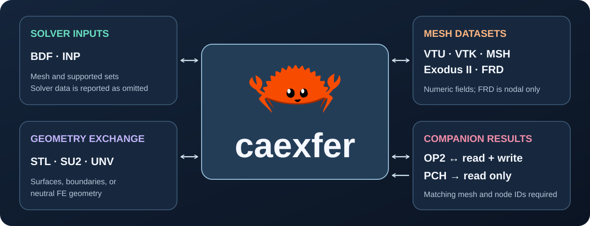
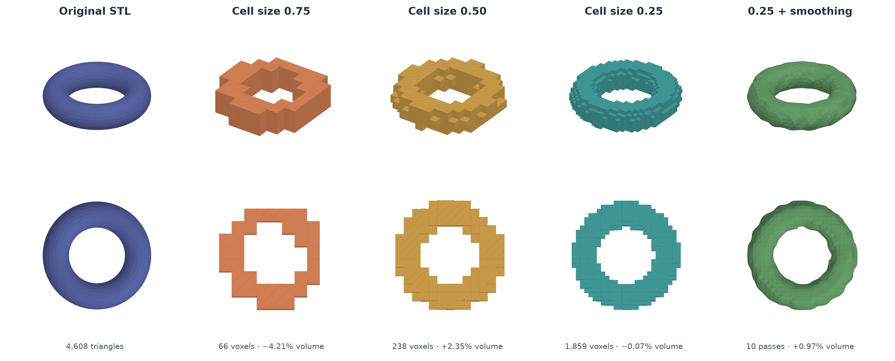
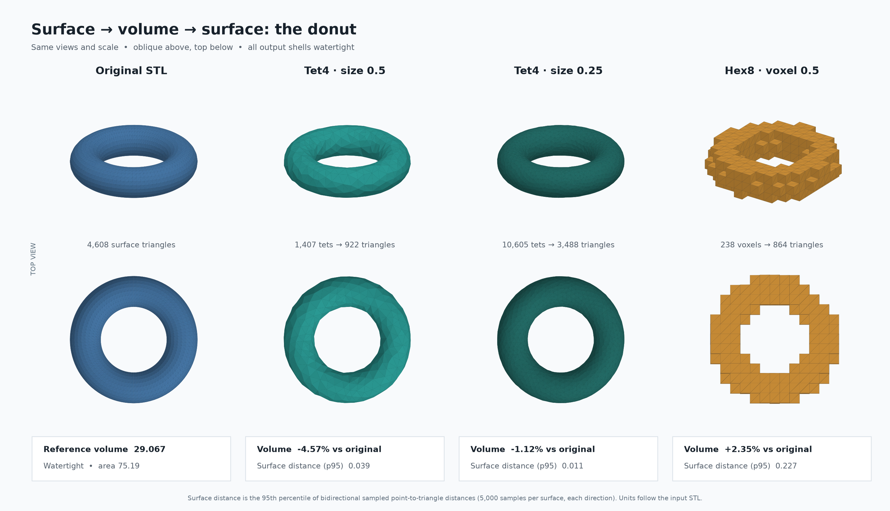

[](https://crates.io/crates/caexfer)
[](https://docs.rs/caexfer)
[](https://github.com/cmccomb/caexfer/actions/workflows/ci.yml)
[](https://github.com/cmccomb/caexfer/actions/workflows/coverage.yml)

# caexfer

<p align="center"></p>

**Transfer finite-element meshes, voxel occupancy, and results across formats.**

`caexfer` reads and writes supported subsets of STL, VTK ImageData VTI,
MagicaVoxel VOX, SU2, UNV, Exodus II, VTU, legacy VTK,
Gmsh MSH 4.1/2.2, Abaqus/CalculiX INP, CalculiX FRD,
Nastran BDF, and Nastran OP2. It also reads PCH displacement results when
given a matching mesh. Each conversion reports omissions and assumptions.

## Get started

Requires Rust 1.86 or newer. Install the published CLI from crates.io:

```sh
cargo install caexfer
caexfer --formats
```

Add the published library to your Rust project:

```sh
cargo add caexfer
```

The CLI and library can perform the same conversions. This sequence carries
nodal results from FRD through VTU to Gmsh MSH 2.2, then reads PCH results
with a matching BDF mesh.

**CLI**

```sh
caexfer convert tests/fixtures/linear-results.frd results.vtu
caexfer convert results.vtu results.msh --msh-version 2.2
caexfer convert tests/fixtures/pch-multiple.pch displacements.vtu \
  --mesh tests/fixtures/pch-companion.bdf --subcase 1
```

**Rust library**

```rust
use caexfer::{MshVersion, Options, Result, convert, validate};

fn main() -> Result<()> {
    let source = validate("tests/fixtures/linear-results.frd", &Options::default())?;
    assert!(source.passed);
    let report = convert("tests/fixtures/linear-results.frd", "results.vtu",
                         &Options { accept_omissions: true, ..Options::default() })?;
    for notice in report.omissions {
        eprintln!("{}: {}", notice.stage.name(), notice.detail);
    }
    convert("results.vtu", "results.msh", &Options {
        msh_version: Some(MshVersion::V2_2),
        accept_omissions: true,
        ..Options::default()
    })?;
    convert("tests/fixtures/pch-multiple.pch", "displacements.vtu", &Options {
        mesh: Some("tests/fixtures/pch-companion.bdf".into()),
        subcase: Some(1),
        accept_omissions: true,
        ..Options::default()
    })?;
    Ok(())
}
```

`convert` lists reported losses and assumptions before asking for confirmation.
For scripts, pass the specific `--accept-...` flags named in that list, or use
`--accept-all` to accept every reported change.

## Conversion routes

[](assets/conversion-flow.svg)

`caexfer --formats` lists the current readers and writers. Mesh sources can be
converted when the destination supports their cell types and data. VTU, legacy
VTK, MSH, and classic Exodus carry numeric fields within their documented
subsets; FRD carries nodal fields. BDF, INP, STL, SU2, and UNV provide narrower
geometry routes. MSH physical groups become named selections, and SU2 carries
named boundary markers. OP2 and PCH displacement results require a companion
mesh with original node IDs; OP2 can write a selected displacement table, while
PCH is read-only.

VTI and VOX carry binary voxel occupancy. Convert a closed triangle or quad
surface (including STL), or the external boundary of a linear volume mesh,
with `--infill-shape hex8 --infill-unit-size N`. Voxel input becomes shared-corner Hex8 volume cells in
mesh formats or exposed, triangulated faces in STL. A volume mesh can become a
triangle surface mesh with `--surface`. Any closed triangle or quad surface
mesh can become a voxelized Hex8 volume mesh with the same infill flags. For a
surface-conforming Tet4 volume mesh, use `--infill-shape tet4` with Gmsh on
`PATH` or pass `--gmsh /path/to/gmsh` (tested with Gmsh 4.15.2):

`--infill-shape tet4|hex8|wedge6|pyramid5` and `--infill-unit-size N`
provide one interface for volume meshing. Tet4 follows the input surface.
Hex8, Wedge6, and Pyramid5 sample occupancy on a cubic grid of edge length
`N`; each occupied cube yields one hex, two wedges, or six pyramids. All
three grid shapes have the same stepped exterior at a given size. VTI and VOX
output from a mesh accepts `hex8` infill; converting an existing VTI or VOX
grid needs no infill flags.

```sh
caexfer convert closed.stl solid.vti --infill-shape hex8 --infill-unit-size 0.5 --accept-omissions
caexfer convert solid.vti solid.vox --accept-omissions
caexfer convert solid.vox shell.stl --accept-omissions
caexfer convert solid.vti smooth-shell.stl --smooth-iterations 10 --accept-omissions
caexfer convert closed.stl volume.vtu --infill-shape hex8 --infill-unit-size 0.5 --accept-omissions
caexfer convert volume.vtu shell.vtu --surface --accept-omissions
caexfer convert shell.vtu rebuilt-volume.vtu --infill-shape hex8 --infill-unit-size 0.5 --accept-omissions
caexfer convert shell.vtu tets.vtu --infill-shape tet4 --infill-unit-size 0.5 --accept-omissions
caexfer convert shell.vtu wedges.vtu --infill-shape wedge6 --infill-unit-size 0.5 --accept-omissions
caexfer convert shell.vtu pyramids.vtu --infill-shape pyramid5 --infill-unit-size 0.5 --accept-omissions
caexfer convert another.stl aligned.vti --match-grid solid.vti --accept-omissions
```

`--match-grid` uses an existing VTI file's origin, spacing, and dimensions for
Hex8 sampling so separate meshes land on the same cells. Geometry outside that
grid is rejected rather than clipped. The read-only conversion preview shows
source counts, reported losses, and voxel work before writing an output.

Surface extraction keeps source point values and discards cell values, sets,
and property IDs; extracted faces receive new element IDs. Volume meshing
replaces the original point and element IDs and discards numeric fields, sets,
and property IDs. Gmsh may remesh the boundary and the intermediate STL uses
float32 coordinates. Both operations report these changes for acceptance.
Tetrahedralization currently requires one closed manifold surface. The
infill unit size supplies a target edge size to Gmsh. See [Gmsh's STL remeshing tutorial](https://gmsh.info/doc/texinfo/gmsh.html#t13).

### Donut voxel round trip

The [donut STL](examples/donut.stl) is a closed, curved torus with a center hole
and 4,608 triangles. This comparison samples it into VTI occupancy at three
cell sizes, then exports each grid back to STL. Every view uses the same camera
and scale.



The 0.75 grid has 66 occupied cells and differs from the original by −4.21%
in enclosed volume. At 0.50, 238 cells differ by +2.35%; at 0.25, 1,859 cells
differ by −0.07%. All reconstructed STL surfaces are watertight and retain the
hole. The near-zero volume difference at 0.25 does not mean the local surface
is exact: voxel steps remain. Ten smoothing passes round those steps and give
a +0.97% volume difference, but cannot recover detail smaller than a cell.

Reproduce the finer round trip from a checkout of this branch:

```sh
cargo run -- convert examples/donut.stl donut.vti --infill-shape hex8 --infill-unit-size 0.25 --accept-omissions
cargo run -- convert donut.vti donut-roundtrip.stl --accept-omissions
cargo run -- convert donut.vti donut-smoothed.stl --smooth-iterations 10 --accept-omissions
```

These are voxel-center samples and blocky meshes, not conforming tetrahedral
meshing. VOX has no physical origin or spacing, and its palette is not carried
through the occupancy model. The conversion report lists those losses.
The optional `--smooth-iterations N` (1–50) moves shared surface vertices with
paired smoothing passes when exporting VTI or VOX to STL. It rounds the voxel
steps but can soften small features and does not recover detail lost during
voxelization. Without this option, STL output follows voxel boundaries exactly.

### Surface ↔ volume round-trip check

The same donut was converted to Tet4 volume meshes with Gmsh 4.15.2 and back
to STL. The 0.5 voxel result is shown at the same camera and scale for
comparison. Every output shell is watertight and retains the hole.



| Route | Volume cells | Output triangles | Enclosed volume change | Surface distance p95 |
| --- | ---: | ---: | ---: | ---: |
| Tet4, target size 0.5 | 1,407 | 922 | −4.57% | 0.039 |
| Tet4, target size 0.25 | 10,605 | 3,488 | −1.12% | 0.011 |
| Hex8 voxels, size 0.5 | 238 | 864 | +2.35% | 0.227 |

Surface distance is the 95th percentile of bidirectional point-to-triangle
distances from 5,000 seeded samples per surface in each direction; coordinates
retain the input STL's unspecified units. Cell counts and IDs change with
remeshing. As a separate volume → surface → volume check, a cube began with
196 Tet4 cells and returned with 298; its boundary stayed on the same six
planes and its enclosed volume remained 1.0.

```sh
caexfer convert examples/donut.stl donut-tets.vtu --infill-shape tet4 --infill-unit-size 0.25 --accept-omissions
caexfer convert donut-tets.vtu donut-tets-roundtrip.stl --accept-omissions
```
